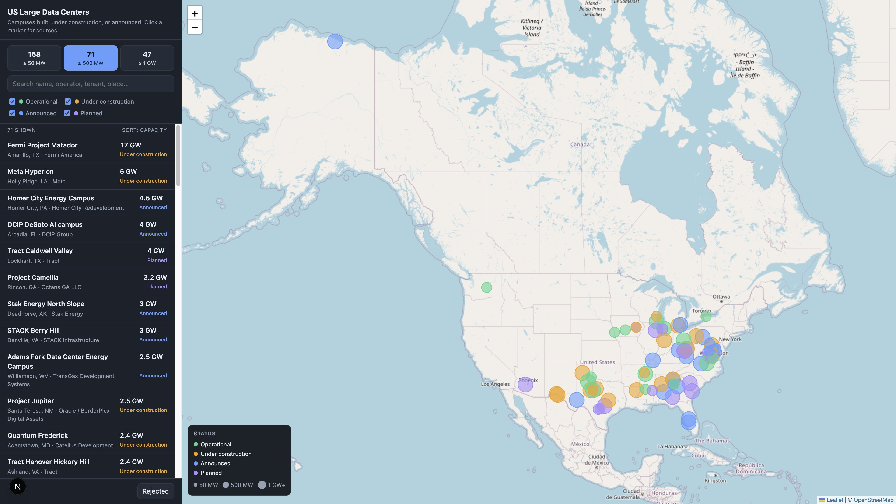

# US Large Data Center Map

A local map of large data centers in the United States: campuses that are
operational, under construction, or announced, from 50 MW up. Data lives in a
local SQLite database so it is never regenerated, and entries you mark as not
real stay out permanently.



The public site at [data-centers.vorga.org](https://data-centers.vorga.org) is a static
copy of this data. "Mark as not real" there is remembered only in that
browser. To change the published dataset, edit the data locally and redeploy
with `bun run deploy`.

## Run it

```bash
npm install
npm run dev
```

Open http://localhost:3000. The database (`data/datacenters.db`, gitignored) is
created automatically and seeded from `data/seed.json` plus the blocklist in
`data/rejected.json` on first run.

## Using the map

- **Tier buttons** (≥ 50 MW, ≥ 500 MW, ≥ 1 GW) filter by the larger of current
  and planned capacity. Counts are over the whole dataset, not the filters.
- **Status checkboxes** and the **search box** filter the markers and the list.
  Click a row to fly the map to it; click a marker for the popup and details.
- **Details** show operator, owner, tenant, capacity now and planned, dates,
  investment, power source, utility, acreage, and the source links.
- **Mark as not real** moves the entry to the rejected list with an optional
  reason. It disappears from the map and will be skipped by every future
  import, even if the same campus comes back under another of its names or
  within 2 km of the rejected location.
- **Rejected** (bottom of the sidebar) lists them; **Restore** puts one back on
  the map and lifts the block.

## Data

`data/seed.json` is the checked-in dataset, one object per campus (phases of
the same campus are merged, with `planned_mw` holding the full build-out).
Every entry cites at least one source. `confidence` is `high`, `medium`, or
`low` when the sourcing is thin.

Sources, in order of preference: company press releases, utility and state
filings, grid operator (ERCOT, PJM, MISO) large-load information, Epoch AI's
[frontier data centers database](https://epoch.ai/data/data-centers), then
trade and local press (DatacenterDynamics, Data Center Frontier, Bloomberg,
Reuters). Capacity figures for announced projects move fast and often
contradict each other; the `notes` and `sources` fields say where each number
came from.

## Adding data centers

Ask the agent in this repo, for example: *"Find data centers in Arizona that
aren't on the map"* or *"Add the new Vantage campus in Wisconsin."* The agent
researches them, writes a JSON file under `data/imports/`, and runs the import.

The import format is either a plain array of entries, or an object that can
also record rejections:

```json
{
  "datacenters": [
    {
      "name": "Example Campus",
      "aliases": ["codename"],
      "operator": "Example Co",
      "owner": null,
      "tenant": "Some AI lab",
      "city": "Springfield",
      "county": "Sangamon",
      "state": "IL",
      "lat": 39.78,
      "lon": -89.65,
      "capacity_mw": null,
      "planned_mw": 750,
      "status": "announced",
      "announced_date": "2026-03",
      "expected_completion": "2028",
      "investment_usd": 5000000000,
      "power_source": "Grid",
      "utility": "Ameren",
      "acreage": 400,
      "notes": "One to three factual sentences.",
      "confidence": "medium",
      "sources": [{ "url": "https://example.com/story", "title": "Story", "retrieved": "2026-11-08" }]
    }
  ],
  "reject": [
    { "name": "Rumored Campus", "state": "IL", "reason": "never permitted, local press retracted" }
  ]
}
```

`status` is one of `operational`, `under_construction`, `announced`,
`planned`. At least one source URL is required, and coordinates must fall
inside the US extent.

```bash
npm run import -- data/imports/my-file.json
```

The importer validates with zod, skips anything matching the rejected list
(by name or alias, or within ~2 km of a rejected site), and otherwise upserts:
an entry matching an existing campus (a shared name or alias in the same
state, or within ~1 km with the same operator) is merged into it, with the
incoming values filling in and aliases and sources combined. Short code-like
aliases such as "ORD01" are not treated as identity, since unrelated sites
reuse them. Nothing is ever deleted by an import.

```bash
npm run seed            # idempotent re-import of data/seed.json + data/rejected.json
npm run seed -- --reset # wipe the datacenters table first (rejections are kept)
npm run export          # write the database back out to data/seed.json and data/rejected.json
```

`npm run export` is how edits made through the UI (including rejections) get
persisted into the checked-in files. Run it after rejecting or restoring
entries if you want those decisions to survive a fresh database.
